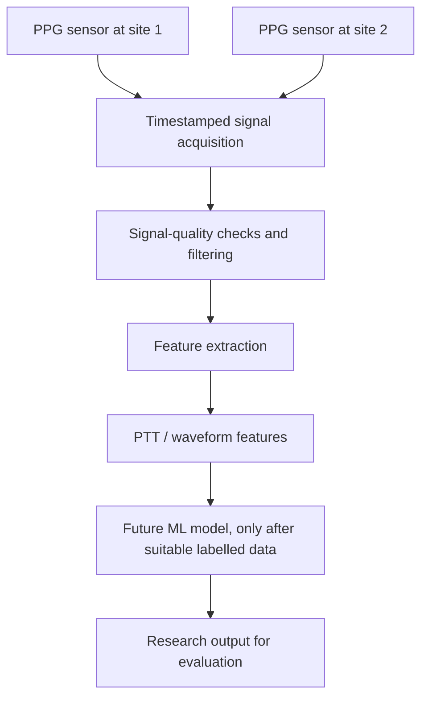

# CardioSense
### Dual-site PPG for exploratory cardiovascular-risk assessment

CardioSense is a student engineering project exploring whether pulse-wave signals captured at two body locations can be processed into features that may support cardiovascular-risk research. The concept combines optical sensing, embedded acquisition, digital signal processing, and a future machine-learning workflow.

> **Project status:** Concept and prototype presented at Eureka! 2026. This repository is a development scaffold. The code here is starter code, not a claim that a complete measurement or prediction system has been validated.

## Concept

The proposed system captures pulse-related optical signals at two sites (the project presentation proposes the neck and wrist), processes the signals, extracts timing/shape features, and eventually evaluates whether those features can support a machine-learning estimate.



## What is implemented in this repository?

| Component | Status | Notes |
|---|---|---|
| Project overview and architecture | Documented | Based on the project concept and presentation |
| ESP32 acquisition sketch | Starter code | Assumes two analog-output signal modules; adapt to actual hardware |
| Python CSV inspection/filtering | Starter code | Requires timestamped CSV recordings |
| PTT estimation | Experimental starter | Requires synchronized signals and careful validation |
| AIx and RI extraction | Not implemented | Waveform definitions, signal quality, and reference validation are still needed |
| ML training and prediction | Not implemented as a usable model | A scaffold is provided; real, ethically sourced labelled data is required |
| Clinical validation | Not performed | The project is not a clinically validated device |

## Repository structure

```text
CardioSense/
├── README.md
├── CONTRIBUTING.md
├── LICENSE
├── requirements.txt
├── docs/                  # Architecture, development plan, safety notes
├── hardware/              # Component assumptions and wiring notes
├── firmware/              # ESP32 acquisition starter
├── signal_processing/     # CSV loading, filtering, exploratory PTT
├── machine_learning/      # Data requirements and training scaffold
├── data/raw/              # Put private/local recordings here; ignored by Git
├── data/processed/        # Processed data; ignored by Git
├── results/               # Generated plots/reports; ignored by Git by default
└── images/                # Project visuals you have permission to publish
```

## Quick start: Python tools

1. Install Python 3.10 or newer.
2. Create and activate a virtual environment.
3. Install dependencies:

   ```bash
   python -m venv .venv
   # Windows PowerShell: .venv\Scripts\Activate.ps1
   # macOS/Linux: source .venv/bin/activate
   python -m pip install -r requirements.txt
   ```

4. Prepare a CSV file with columns `timestamp_us`, `site1`, and `site2` (timestamps in microseconds). Save it locally under `data/raw/`.
5. Run the exploratory plotter:

   ```bash
   python signal_processing/analyze_ppg.py data/raw/your_recording.csv
   ```

This script visualizes and filters the signals. Its optional PTT estimate is exploratory and must not be treated as a reliable measurement without validation.

## ESP32 starter

Open `firmware/esp32_ppg_acquisition/esp32_ppg_acquisition.ino` in Arduino IDE. The sketch assumes two **analog-output** sensor modules connected to ESP32 ADC pins 34 and 35. Confirm your exact sensor/module datasheet and output voltage before wiring; do not connect a signal above the ESP32's allowed input range. The sketch streams CSV over USB serial and does not calculate clinical features.

## Data and privacy

- Do not commit identifiable, personal, or sensitive recordings.
- Use consented, ethically sourced data and follow your institution's requirements.
- `data/raw/`, `data/processed/`, and generated result files are ignored by Git by default.
- Never commit passwords, API keys, Wi-Fi credentials, or private participant information.

## Limitations and responsible use

CardioSense is an engineering/research project, not a diagnostic tool. PPG-derived features can be affected by movement, sensor placement, contact pressure, ambient light, individual variation, and synchronization errors. Vessel stiffness or cardiovascular risk cannot be established from these features alone. Any risk model would need appropriate reference labels, independent evaluation, and relevant regulatory/clinical review before real-world medical use.

## Development roadmap

- [ ] Confirm exact sensor/module models and document the wiring.
- [ ] Capture synchronized, timestamped recordings and document the sampling rate.
- [ ] Add signal-quality checks and validate filtering choices.
- [ ] Define and validate feature extraction against suitable references.
- [ ] Collect appropriate labelled data under ethical oversight.
- [ ] Train, test, and independently evaluate an ML model only after data and labels are available.
- [ ] Document limitations and reproducible evaluation results.

## Contributors

- Harish K
- Amirtha Varshini Sivakumar

## Recognition

CardioSense received **3rd place at Eureka! 2026**, organized by E-Cell, IIITDM Kancheepuram.

## License

See [LICENSE](LICENSE). If the project includes third-party materials, ensure their licenses and permissions are respected before publishing them.
